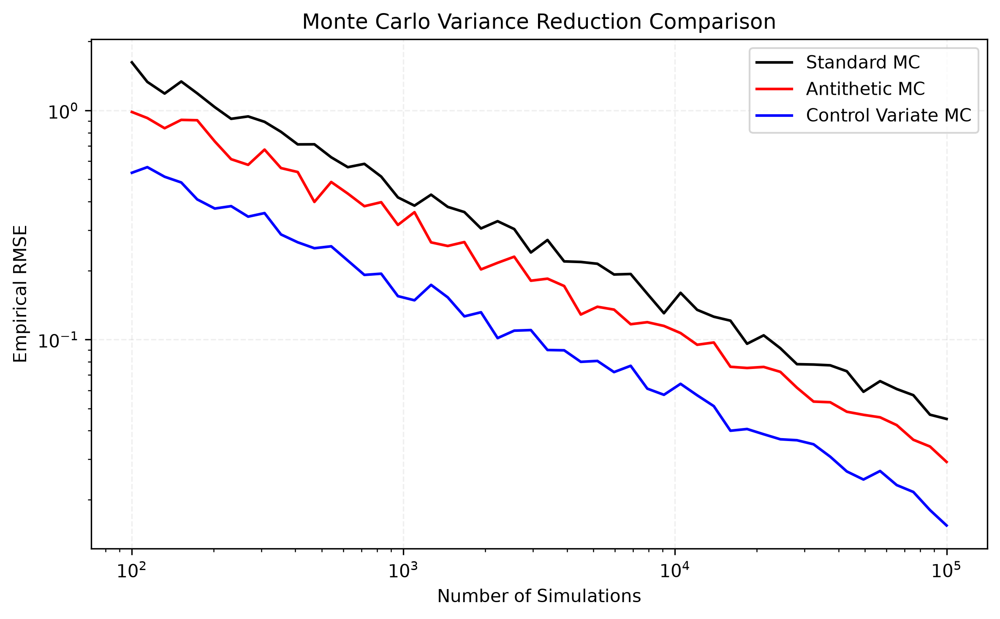
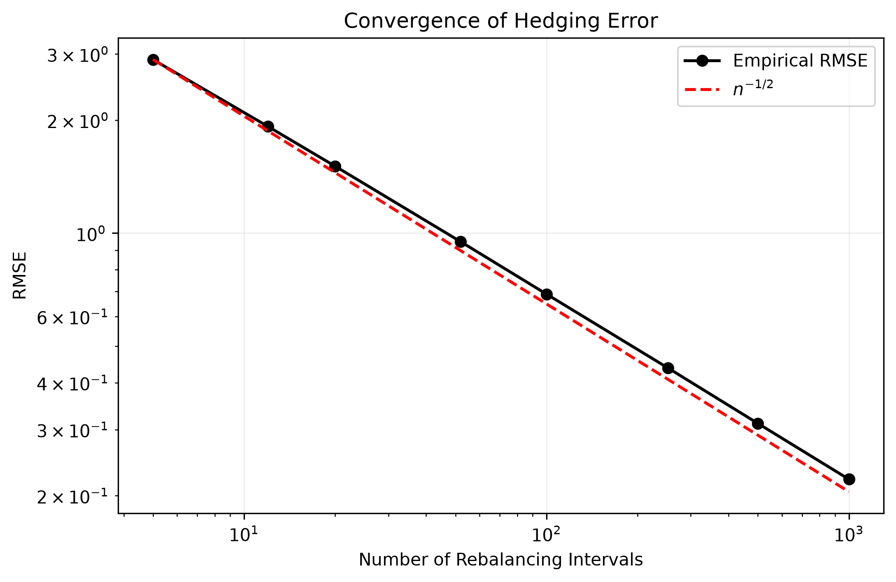
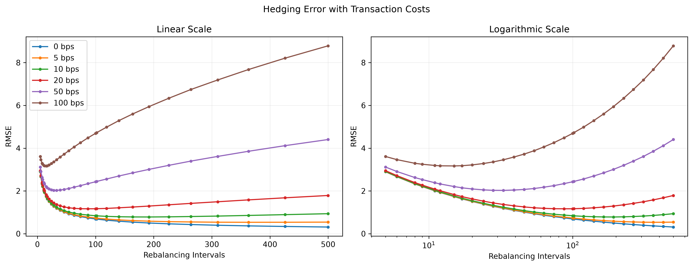
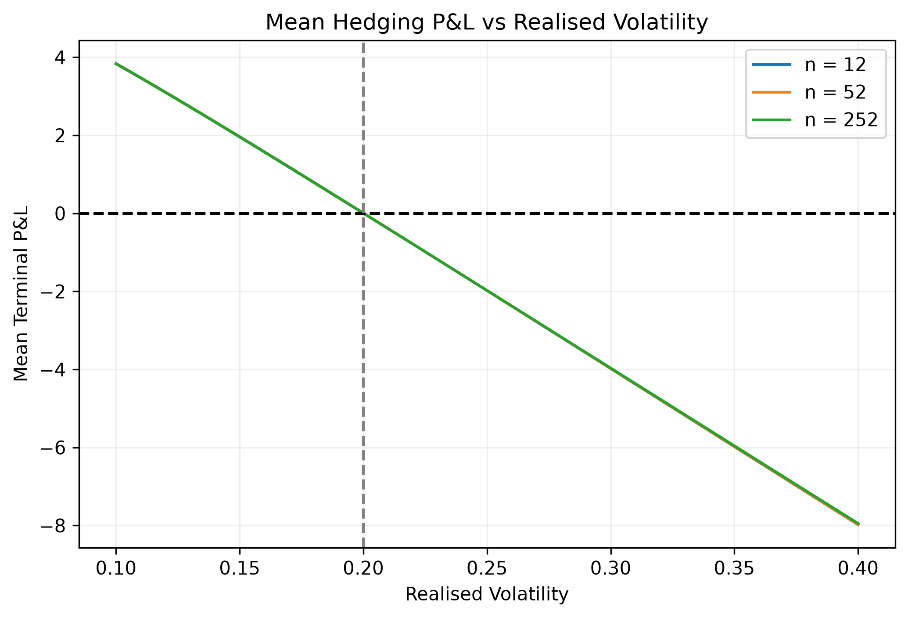

# Dynamic Delta Hedging & Risk Analysis

This project investigates the accuracy of dynamic delta hedging when the assumptions of the Black–Scholes model are relaxed.

The pricing framework is developed from the binomial model through to Black–Scholes, with Monte Carlo simulation used for numerical validation. The analysis then focuses on how rebalancing frequency affects replication error, before examining the impact of transaction costs and volatility misspecification.

## Project Structure

| Notebook | Content |
|---|---|
| [1.0 – Binomial Pricing](notebooks/1.0_binomial_pricing.ipynb) | Replication, risk-neutral valuation and backward induction. |
| [2.0 – GBM Simulation](notebooks/2.0_gbm_simulation.ipynb) | Brownian motion, Itô's lemma, GBM derivation and simulation validation. |
| [3.0 – Black–Scholes](notebooks/3.0_black_scholes.ipynb) | Pricing derivations, analytical Greeks, finite differences and CRR convergence. |
| [4.0 – Monte Carlo Pricing](notebooks/4.0_monte_carlo_option_pricing.ipynb) | Confidence intervals, RMSE convergence and variance reduction. |
| [5.1 – Discrete Delta Hedging](notebooks/5.0_dynamic_delta_hedging/5.1_discrete_delta_hedging.ipynb) | Self-financing portfolio replication. |
| [5.2 – Rebalancing Frequency](notebooks/5.0_dynamic_delta_hedging/5.2_rebalancing_frequency.ipynb) | Convergence of discrete hedging error. |
| [5.3 – Transaction Costs](notebooks/5.0_dynamic_delta_hedging/5.3_transaction_costs.ipynb) | Hedging RMSE under proportional trading costs. |
| [5.4 – Volatility Misspecification](notebooks/5.0_dynamic_delta_hedging/5.4_volatility_misspecification.ipynb) | P&L sensitivity to volatility mismatch. |

## Methodology

A short European call is hedged using a stock and cash portfolio, initialised at the Black–Scholes premium. The initial cash balance and terminal hedging error are

$$
B_0=C_0-\Delta_0 S_0,
\qquad
\varepsilon_T=B_T+\Delta_{n-1}S_T-(S_T-K)^+.
$$

The stock position is adjusted at discrete intervals using Black–Scholes Delta. The cash balance accounts for interest, rebalancing cash flows and transaction costs where applicable.

The baseline parameters are $S_0=K=100$, $T=1$, $r=5\%$ and $\sigma=20\%$. Asset prices are simulated under GBM using vectorised NumPy operations and processed in batches to limit memory consumption.

Hedging performance is evaluated using the mean, standard deviation and root mean squared error of terminal P&L across $M$ simulated paths:

$$
\widehat{\mathrm{RMSE}}=\sqrt{\frac{1}{M}\sum_{i=1}^{M}(\varepsilon_T^{(i)})^2}.
$$

At the population level,

$$
\mathrm{RMSE}^2=\mathrm{Var}(\varepsilon_T)+\big(\mathbb{E}[\varepsilon_T]\big)^2.
$$

RMSE therefore captures both the dispersion of hedging outcomes and systematic deviations from zero P&L.

## Results

### Option Pricing and Variance Reduction

Increasing the CRR binomial model from 100 to 4,000 time steps reduced absolute pricing error from approximately 0.01997 to 0.00050, consistent with $O(n^{-1})$ convergence for the parameters and step counts tested. Standard Monte Carlo exhibits the expected $O(N^{-1/2})$ RMSE convergence rate.

At 10,480 terminal-price evaluations per estimate, antithetic and control variates reduced empirical MSE by factors of 2.24 and 6.23 respectively. The control-variate coefficient was estimated using an additional independent pilot sample of 50,000 observations.



### Discrete Hedging and Rebalancing Frequency

Across 1,000,000 simulated paths with 100 rebalancing intervals and no transaction costs, the baseline mean hedging error was $-3.26\times10^{-5}$, with an RMSE of 0.6894.

| Rebalancing intervals | RMSE |
|---:|---:|
| 12 | 1.9226 |
| 52 | 0.9490 |
| 100 | 0.6881 |
| 252 | 0.4376 |
| 1,000 | 0.2212 |

Increasing the number of intervals from 12 to 252 reduced RMSE by 77.2%. A log-log fit across all eight tested frequencies gives a slope of approximately -0.487, consistent with $\mathrm{RMSE}\propto n^{-1/2}$.



### Transaction Costs

Proportional transaction costs introduce a trade-off between discrete replication error and trading expenditure. The number of rebalancing intervals that minimises empirical RMSE over the tested grid decreases as the cost rate increases.

| Transaction cost (bps) | RMSE-minimising intervals | Minimum RMSE |
|---:|---:|---:|
| 0 | 500 | 0.3110 |
| 5 | 363 | 0.5331 |
| 10 | 192 | 0.7808 |
| 20 | 87 | 1.1642 |
| 50 | 33 | 2.0250 |
| 100 | 15 | 3.1686 |

At 10 bps, RMSE is minimised at 192 intervals, compared with 33 at 50 bps. Without transaction costs, the minimum occurs at the upper boundary of the tested grid.



### Volatility Misspecification

Pricing and hedging volatility are fixed at 20%, while realised volatility is varied.

| Realised volatility | Mean P&L ($n=12$) | Std. dev. ($n=12$) | Mean P&L ($n=252$) | Std. dev. ($n=252$) |
|---:|---:|---:|---:|---:|
| 10% | 3.838 | 1.394 | 3.832 | 1.076 |
| 20% | 0.007 | 1.925 | 0.001 | 0.437 |
| 30% | -3.979 | 3.421 | -3.968 | 1.923 |

For the short call, overestimating volatility produces positive mean P&L, while underestimating volatility produces negative mean P&L. More frequent hedging reduces P&L dispersion but has little effect on the mean P&L arising from volatility mismatch.



These results are specific to the simulated GBM framework and parameter choices; they are not estimates of historical or live trading performance.

## Installation and Usage

The notebooks use Python, NumPy, SciPy and Matplotlib. From the repository root, install the dependencies:

```bash
python -m pip install -r requirements.txt
```

Open the notebooks in VS Code or Jupyter and select the Python environment containing the dependencies. Run each notebook from its containing directory to preserve the relative figure export paths.